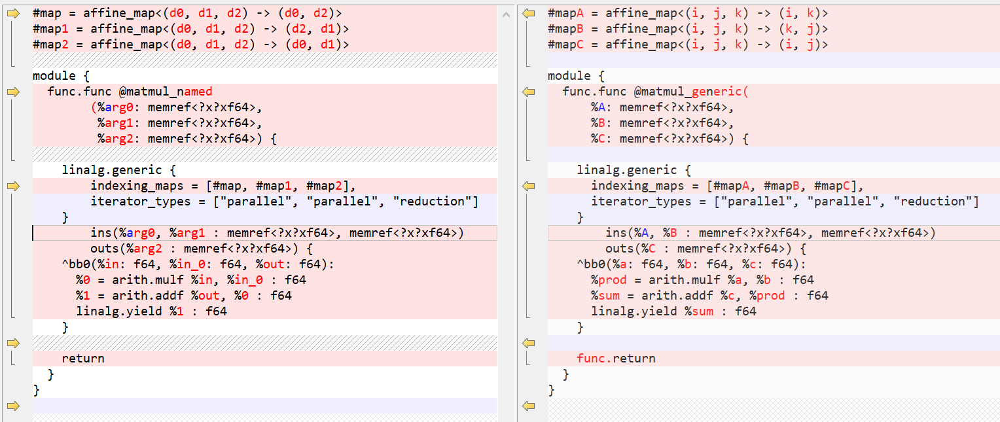

# MLIR Assignment Report

## Part 1: Matrix Multiplication in MLIR

### Task 1: Build LLVM/MLIR and the starter project

The build steps are in [build.sh](part1/task1/build.sh). The script builds and installs LLVM/MLIR, then builds and tests the starter project.

I used `llvmorg-23.1.3` and enabled MLIR with `LLVM_ENABLE_PROJECTS=mlir`. `LLVM_ENABLE_ASSERTIONS=ON` keeps internal checks enabled, and `LLVM_INSTALL_UTILS=ON` installs `FileCheck` for the starter tests.

The script sets `MLIR_DIR` and `LLVM_DIR` to this installation and builds the `check-standalone-opt` target to build the tool and run its tests. Finally, it runs `standalone-opt --show-dialects` to display the registered dialects.

### Task 2: Express matrix multiplication in Linalg

The handwritten implementations are [matmul_named.mlir](part1/task2/matmul_named.mlir) and [matmul_generic.mlir](part1/task2/matmul_generic.mlir). The commands are in [run.sh](part1/task2/run.sh), which verifies both files with `mlir-opt` and prints their IR. It also runs the verifier on [matmul_generic_changed.mlir](part1/task2/matmul_generic_changed.mlir) for Q3.

#### Comparison of the converted and handwritten versions

I used the upstream `linalg-generalize-named-ops` pass to convert `linalg.matmul` to `linalg.generic`. The script saves the generated IR to [matmul_named_generalized.mlir](part1/task2/matmul_named_generalized.mlir).

The converted `@matmul_named` and handwritten `@matmul_generic` have the same indexing maps, iterator types, and multiply-add body. Both compute `C += A * B`.



_Left: converted `@matmul_named`; right: handwritten `@matmul_generic`._

The differences are in naming: `#map/#map1/#map2` instead of `#mapA/#mapB/#mapC`, `d0/d1/d2` instead of `i/j/k`, and different variable names. The function stays named `@matmul_named` because the pass converts the operation without renaming the function. `return` is shorthand for `func.return`.

#### Q1.

At iteration `(d0, d1, d2)`:

| Operand | Indexing map               | Element accessed |
| ------- | -------------------------- | ---------------- |
| A       | `(d0, d1, d2) -> (d0, d2)` | `A[d0, d2]`      |
| B       | `(d0, d1, d2) -> (d2, d1)` | `B[d2, d1]`      |
| C       | `(d0, d1, d2) -> (d0, d1)` | `C[d0, d1]`      |

The iterator types are `["parallel", "parallel", "reduction"]` for `d0`, `d1`, and `d2`, respectively.

#### Q2.

- **Why is C an outs operand?** C is updated during the computation: its existing value is read for accumulation, and the updated result is written back to it.

- **What value does its block argument hold?** The block argument corresponding to C is `%c`:

  ```mlir
  ^bb0(%a: f64, %b: f64, %c: f64):
    %prod = arith.mulf %a, %b : f64
    %sum = arith.addf %c, %prod : f64
    linalg.yield %sum : f64
  ```

  The `outs` operand provides the current `f64` value of `C[d0, d1]` as `%c`. The body computes `%c + %prod`, and `linalg.yield %sum` supplies the updated value to be written back to C. The first reduction iteration uses C's initial value; later iterations use the value updated by the previous reduction iteration.

- **Does linalg.matmul initialize C to zero?** No. It computes `C += A * B` using the existing values of C.

#### Q3.

- **Which iterator is a reduction, and why?** `d2` (the k dimension) is the reduction iterator. For fixed `d0` and `d1`, each iteration computes `A[d0, d2] * B[d2, d1]` and adds this product to `C[d0, d1]`. As `d2` varies, these products are combined into the same accumulated result.

- **Does verification succeed after changing it to parallel?** Yes. I changed the third iterator to `parallel` in [matmul_generic_changed.mlir](part1/task2/matmul_generic_changed.mlir), so the iterator types are `["parallel", "parallel", "parallel"]`. The modified file is accepted by `mlir-opt`. This check is also included in [run.sh, lines 19–20](part1/task2/run.sh#L19-L20).

- **Is the annotation correct?** No. A later `d2` iteration reads the accumulator value written by the preceding iteration for the same `C[d0, d1]`, creating a loop-carried RAW dependence. These iterations are therefore not independent, so the `parallel` annotation is incorrect. The Linalg documentation requires iterator types to agree with the computation inside the region; violating parallel iterator requirements is undefined behavior.

### Task 3: Lower to loops

The lowering commands are in [part1/task3/run.sh](part1/task3/run.sh). The generated IR with comments is available in the [SCF version](part1/task3/matmul_generic_scf_comments.mlir) and the [Affine version](part1/task3/matmul_generic_affine_comments.mlir).

#### Q4.

- **Which passes did you use?** I used `--convert-linalg-to-loops` to generate `scf.for` loops and `--convert-linalg-to-affine-loops` to generate `affine.for` loops.

- **how did you find them?** I searched `mlir-opt --help` with `grep "loops"` and checked their descriptions in the official documentation to select these passes: [convert-linalg-to-loops](https://mlir.llvm.org/docs/Passes/#-convert-linalg-to-loops) and [convert-linalg-to-affine-loops](https://mlir.llvm.org/docs/Passes/#-convert-linalg-to-affine-loops).

### Task 4: Loop interchange

The commands for applying the interchange and lowering the result to loops are in [run.sh](part1/task4/run.sh).

The interchanged IR with comments is available in the [SCF version](part1/task4/matmul_interchanged_scf_comments.mlir) and the [Affine version](part1/task4/matmul_interchanged_affine_comments.mlir).

#### Q5.

The original loop order is `i → j → k`. I chose `i → k → j` by interchanging the `j` and `k` loops.

With row-major storage, the accesses in the innermost loop are:

| Access    | Original order: `i → j → k` (`k` innermost)           | Chosen order: `i → k → j` (`j` innermost) |
| --------- | ----------------------------------------------------- | ----------------------------------------- |
| `A[i, k]` | Consecutive elements along a row                      | Same element                              |
| `B[k, j]` | Elements down a column, with a stride of `N` elements | Consecutive elements along a row          |
| `C[i, j]` | Same element                                          | Consecutive elements along a row          |

In the chosen order `i → k → j` (`j` innermost), every innermost access is either contiguous or unchanged across iterations. This removes the large-stride access to B and improves the spatial locality of accesses to B, which may improve cache efficiency.

#### Q6.

- **How did you apply the interchange?** I applied the interchange at the Linalg level, before lowering to SCF or Affine loops:
  1. In [interchange.mlir](part1/task4/interchange.mlir), `transform.structured.match` selects `linalg.generic`.

  2. `transform.structured.interchange` applies `iterator_interchange = [0, 2, 1]`. This changes the iteration order from `i → j → k` to `i → k → j`, updating the indexing maps and iterator types accordingly.

  3. In [run.sh](part1/task4/run.sh), `--transform-preload-library` loads the script and `--transform-interpreter` executes it. The result is saved as [matmul_interchanged_linalg.mlir](part1/task4/matmul_interchanged_linalg.mlir).

  4. The interchanged Linalg IR is lowered separately to [SCF loops](part1/task4/matmul_interchanged_scf.mlir) using `--convert-linalg-to-loops` and [Affine loops](part1/task4/matmul_interchanged_affine.mlir) using `--convert-linalg-to-affine-loops`.

- **Does the same approach work directly on `@matmul_named`? Why or why not?**

  No, our script matches `linalg.generic`, while `@matmul_named` contains `linalg.matmul`.

  The [official documentation](https://mlir.llvm.org/docs/Dialects/Transform/#transformstructuredinterchange-transforminterchangeop:~:text=This%20operation%20ignores%20non%2Dlinalg%3A%3AGeneric%20ops%20and%20drops%20them%20in%20the%20return.) indicates that `transform.structured.interchange` requires a `linalg.generic` target.

  This is also reflected in the [source definition of InterchangeOp](https://github.com/llvm/llvm-project/blob/4330469cc1694be36cf20cfca9f6dae408e9fbc3/mlir/include/mlir/Dialect/Linalg/TransformOps/LinalgTransformOps.td#L730), where `extraClassDeclaration` declares `applyToOne` with a `linalg::GenericOp target` parameter.

  We can first use `--linalg-generalize-named-ops` to convert `linalg.matmul` to `linalg.generic`, then apply the same interchange script.

#### Q7.

- **Why is moving the reduction loop legal here?**

  Assuming C does not overlap A or B, the inputs are read-only and different output elements can be updated independently.

  The accumulation introduces a loop-carried RAW dependence between successive `k` iterations updating the same `C[i, j]`. After changing the loop order from `i → j → k` to `i → k → j`, `k` remains sequential and this dependence is preserved.

  For adjacent `k` iterations, the dependence distance vector changes from `(0, 0, 1)` to `(0, 1, 0)`, whose first non-zero component is still positive. Therefore, the interchange does not reverse the dependence.

- **Does your interchange preserve the accumulation order for each element of C?**

  Yes. For any fixed `i` and `j`, the products `A[i, k] * B[k, j]` are still added to the initial value of `C[i, j]` in increasing order of `k`, from `0` to `K - 1`. Updates to different output elements are interleaved differently, but the sequence of partial sums for each element is unchanged. Therefore, this interchange does not regroup the floating-point additions.

### Task 5: Lower to LLVM, link and run

The compilation and execution commands are in [run.sh](part1/task5/run.sh). I used the [original SCF version](part1/task3/matmul_generic_scf.mlir) and the [interchanged SCF version](part1/task4/matmul_interchanged_scf.mlir) from task3 and task4. Running `run.sh` creates `part1/task5/build/` and saves the generated LLVM dialect and LLVM IR files, object files, and the executable `matmul_run` there.

The script generates the following IR files: the original version ([LLVM dialect](part1/task5/matmul_original_llvm.mlir), [LLVM IR](part1/task5/matmul_original.ll)) and the interchanged version ([LLVM dialect](part1/task5/matmul_interchanged_llvm.mlir), [LLVM IR](part1/task5/matmul_interchanged.ll)). All four IR files include comments. Both versions are compiled to object files and linked with [matmul_driver.c](part1/task5/matmul_driver.c) to produce `part1/task5/build/matmul_run`.

The driver uses `M = 512`, `K = 768`, and `N = 1024` to check `C += A * B`. The C reference uses the original `i → j → k` order, and each MLIR result is compared with it using `memcmp` to check bit-identical results. The C driver is compiled with `-O0 -ffp-contract=off` to prevent FMA contraction in the calculation.

Both versions passed the bit-identical comparison against the C reference. All four IR files include comments identifying the loops, loads from `A`, `B` and `C`, the multiply-add computation, and the store to `C`.

#### Q8.

- **Full pipeline from `.mlir` to executable**

  Both versions are lowered from Linalg to SCF using `--convert-linalg-to-loops`, as described in Tasks 3 and 4. The remaining commands are in [run.sh](part1/task5/run.sh).

  ```text
  Linalg mlir
      ↓ --convert-linalg-to-loops
  SCF mlir
      ↓ apply the seven passes below
  LLVM dialect mlir
      ↓ mlir-translate --mlir-to-llvmir
  LLVM IR ll
      ↓ llc -O0 -filetype=obj -relocation-model=pic
  Two object files + matmul_driver.c
      ↓ clang compiles the driver and links both object files
  matmul_run
  ```

- **What does each MLIR pass do, and what happens if one is omitted?**

  The passes run in the following order. I tested each omission on the original kernel while keeping the rest of the pipeline unchanged ：

  | Pass                         | Purpose                                                                                                                                                                                                                                                              | Effect if omitted                                                                                                                   |
  | ---------------------------- | -------------------------------------------------------------------------------------------------------------------------------------------------------------------------------------------------------------------------------------------------------------------- | ----------------------------------------------------------------------------------------------------------------------------------- |
  | `convert-scf-to-cf`          | Replaces the three `scf.for` loops with basic blocks and `cf.br`/`cf.cond_br` operations, forming a control-flow graph. It also adds `arith.cmpi` operations to check the loop bounds and `arith.addi` operations to increment the loop variables.                   | SCF loops remain unlowered, and `mlir-translate` fails while parsing `scf.for`.                                                     |
  | `convert-arith-to-llvm`      | Replaces Arith operations, including constants, comparisons, additions and multiplications, with LLVM dialect operations. It also inserts temporary conversion casts (`builtin.unrealized_conversion_cast`) to connect converted and unconverted operations.         | Arith operations remain unlowered, and `mlir-translate` fails while parsing `arith.constant`.                                       |
  | `finalize-memref-to-llvm`    | Lowers MemRef operations using LLVM descriptor structs. It converts MemRef queries to LLVM operations and replaces `memref.load` and `memref.store` with address calculations based on descriptor information and indices, followed by `llvm.load` and `llvm.store`. | MemRef operations remain unlowered, and `mlir-translate` fails while parsing `memref.dim`.                                          |
  | `convert-cf-to-llvm`         | Converts CF branches to LLVM dialect branches. It replaces `cf.br` and `cf.cond_br` with `llvm.br` and `llvm.cond_br`.                                                                                                                                               | CF branches remain unlowered, and `mlir-translate` fails while parsing `cf.br`.                                                     |
  | `llvm-request-c-wrappers`    | Adds the `llvm.emit_c_interface` attribute to the function without changing its body. This requests a C-compatible wrapper, which is generated by the following function-conversion pass.                                                                            | LLVM IR translation and object generation succeed, but linking fails with an undefined reference to `_mlir_ciface_matmul_original`. |
  | `convert-func-to-llvm`       | Converts functions from the Func dialect to the LLVM dialect. It uses `llvm.insertvalue` to reconstruct MemRef descriptors from the function arguments. It also generates the requested C wrapper `_mlir_ciface_matmul_original`.                                    | `func.func` remains unconverted, and `mlir-translate` fails because no LLVM translation interface is registered for this operation. |
  | `reconcile-unrealized-casts` | Simplifies and removes redundant temporary conversion casts introduced during lowering.                                                                                                                                                                              | Temporary conversion casts remain, and `mlir-translate` fails to translate `builtin.unrealized_conversion_cast`.                    |

- **Why must the passes run in this order?**

  The order must follow dependencies, but these seven passes do not have only one possible ordering.

  | Ordering dependency                                        | Reason                                                                                                                                |
  | ---------------------------------------------------------- | ------------------------------------------------------------------------------------------------------------------------------------- |
  | `convert-scf-to-cf` before `convert-cf-to-llvm`            | SCF lowering creates CF branches, which must then be converted to LLVM branches.                                                      |
  | `convert-scf-to-cf` before `convert-arith-to-llvm`         | SCF lowering also creates arithmetic operations for loop-variable updates and loop-condition comparisons.                             |
  | `llvm-request-c-wrappers` before `convert-func-to-llvm`    | Function conversion needs the wrapper attribute to generate the C wrapper.                                                            |
  | Other LLVM conversions before `reconcile-unrealized-casts` | This pass cleans up redundant temporary conversion casts introduced by the other conversions, so it should run last in this pipeline. |

## Part 2: A Stencil Dialect

### Task 1: Define the dialect

I defined the Stencil dialect in [StencilDialect.td](include/Stencil/IR/StencilDialect.td) and its operations in [StencilOps.td](include/Stencil/IR/StencilOps.td). The operations are registered in [StencilDialect.cpp](lib/Stencil/IR/StencilDialect.cpp). The verifiers in [StencilOps.cpp](lib/Stencil/IR/StencilOps.cpp) check offsets, shape compatibility and distinct input/output operands.

The two kernels are in [stencil_kernels.mlir](examples/stencil_kernels.mlir). The build and test commands are in [run.sh](part2/task1/run.sh).

I added tests in [test/Stencil](test/Stencil/) to check dialect registration, kernel parsing and printing, and the expected errors for invalid operations.

### Task 2: Lower Jacobi-2D to Linalg

I implemented the `stencil-apply-to-linalg` pass in [StencilApplyToLinalg.cpp](lib/Stencil/Transforms/StencilApplyToLinalg.cpp). It lowers `stencil.apply` to shifted `memref.subview` operations and a `linalg.generic` with identity indexing maps and two parallel iterators. The summation follows the offsets' order, and boundary values remain unchanged.

The commands are in [run.sh](part2/task2/run.sh). The script saves the generated IR to [stencil_kernels_linalg.mlir](part2/task2/stencil_kernels_linalg.mlir). The tests are in [task2](test/Stencil/task2/lower-apply.mlir).

#### Q9.

We assume that A and B are separate, non-overlapping arrays. `stencil.apply` is out-of-place: each iteration reads neighbour values from the unchanged input A and writes a distinct element of B. Shared reads of input elements do not create dependencies. Therefore, iterations along both dimensions are independent, so both iterators can be marked `parallel`.

### Task 3: Lower Seidel-2D to loops

I implemented the `stencil-sweep-to-scf` pass in [StencilSweepToScf.cpp](lib/Stencil/Transforms/StencilSweepToScf.cpp). It lowers `stencil.sweep` to sequential `scf.for` loops. The summation follows the offsets' order, and boundary values remain unchanged.

The commands are in [run.sh](part2/task3/run.sh). The script saves the generated IR to [stencil_kernels_scf.mlir](part2/task3/stencil_kernels_scf.mlir). The tests are in [task3](test/Stencil/task3/lower-sweep.mlir).

#### Q10.

Parallel iterators require that iterations can execute in any order, including in parallel. However, `stencil.sweep` updates the same array in place. For two adjacent interior points, iteration `(i, j-1)` writes `A[i, j-1]`, and iteration `(i, j)` reads that updated value. Similarly, iteration `(i-1, j)` writes `A[i-1, j]`, which is then read by iteration `(i, j)`. These accesses create **loop-carried RAW dependences** in both the `i` and `j` loops: the earlier writes must occur before the later reads. Therefore, these iterations are not independent. A lowering using `parallel` iterators may violate this order, introduce data races, and cause an iteration to read an old value instead of the required updated value.

### Task 4: Compile and run

The compilation and execution commands are in [run.sh](part2/task4/run.sh). The script lowers both kernels to the LLVM dialect, translates them to LLVM IR, and compiles them to an object file.

The object file is linked separately with [jacobi_driver.c](part2/task4/jacobi_driver.c) and [seidel_driver.c](part2/task4/seidel_driver.c). Running the script generates the object file and the two executables, `jacobi_run` and `seidel_run`, in `part2/task4/build/`.

The drivers compare the MLIR results with the corresponding C kernels in [polybench_reference.c](part2/task4/polybench_reference.c), extracted from PolyBench/C 4.2.1-beta.

The C drivers and references are compiled with `-O0 -ffp-contract=off` to prevent FMA contraction in the reference calculations.

Compared with Part 1 Task 5, this pipeline uses two additional passes:

- `--expand-strided-metadata` makes the subview offset, size and stride calculations explicit.
- `--lower-affine` lowers the `affine.apply` operations.

#### Q11.

Yes. With `N = 400` and `TSTEPS = 100`, both kernels produced bit-identical results to their PolyBench/C references.

The lowerings preserve the summation order and the required traversal order. Under the current compilation settings, both paths perform the same arithmetic operations in the same order, so intermediate results are rounded in the same way. Therefore, the complete arrays match bit for bit.

#### Q12.

- **Can division by a constant be replaced by multiplication by its reciprocal without changing the result?**

  Although division by a constant and multiplication by its reciprocal are mathematically equivalent, they do not always produce bit-identical floating-point results.

  The combined rounding error from computing the reciprocal and then multiplying by it (`round(x * round(1 / c))`) may differ from the rounding error of direct division (`round(x / c)`). Therefore, the two calculations are not guaranteed to produce bit-identical results.

  For example, using `double` with round-to-nearest and without fast-math optimizations:

  ```text
  5.0 / 3.0         = 1.6666666666666667
  5.0 * (1.0 / 3.0) = 1.6666666666666665
  ```

  A sufficient condition is that the reciprocal is exactly representable. For finite `double` inputs, `x / 2.0` and `x * 0.5` give identical results under the same IEEE-754 rounding mode because `0.5` is exactly representable.

- **Fast-math flags:** LLVM IR floating-point operations (`fneg`, `fadd`, `fsub`, `fmul`, `fdiv`, ...) may use fast-math flags to enable unsafe floating-point transformations. Individual flags specify particular assumptions or transformation permissions. For example, `nnan` allows the optimizer to assume that operands and results are not NaN, `contract` permits floating-point contraction, such as fusing multiplication and addition into FMA.

  For the division-to-reciprocal transformation, the relevant flag is `arcp`. It allows division to be transformed as a multiplication by a reciprocal. Specifically, this permits `a / b` to be considered equivalent to `a * (1.0 / b)`.

  I traced the IR transformations for `5.0 / 3.0` using `-O3 -ffast-math`. The IR dumps show that `InstCombinePass` replaces the division with multiplication by a reciprocal, using the `arcp` flag.

  Before `InstCombinePass`:

  ```llvm
  %division = fdiv fast double %x, 3.000000e+00
  ```

  After `InstCombinePass`:

  ```llvm
  %division = fmul fast double %x, 0x3FD5555555555555 ;The constant represents the rounded `double` value of `1.0 / 3.0`.
  ```

  This replacement can change rounding results, so bit-identical results to the original division may not be guaranteed.

  In our current pipeline (`-O0`, without fast-math), the division by `9.0` in `stencil.sweep` is retained.
